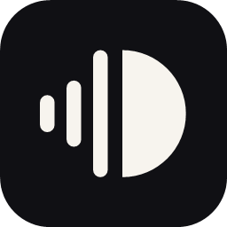

<div align="center">



# Draft

**Private dictation for Windows.**<br>
Hold a key, speak, release. The words appear at your cursor, and your voice never leaves your PC.

[](https://github.com/TirupMehta/draft-rs/releases/latest)

[](LICENSE)


[**Download**](https://github.com/TirupMehta/draft-rs/releases/latest) ·
[Use](#use) ·
[Performance](#performance) ·
[Privacy](#privacy) ·
[Build](#build-from-source) ·
[Docs](#documentation)

<picture>
  <source media="(prefers-color-scheme: dark)" srcset="docs/screenshots/dictate-dark.png">
  
</picture>

</div>

|  **Private** | **Fast** | **Fits your PC** |
| :--- | :--- | :--- |
| Whisper runs on your machine. Audio is captured only while the key is held, then discarded. No account, no telemetry. | About 50× faster than you speak on a GPU: a minute of speech in 1.19 s. | Seven models from 85 MB to 1.6 GB. Draft measures your PC and recommends one. |

## Install

Download an installer from the [latest release](https://github.com/TirupMehta/draft-rs/releases/latest) and run it. No administrator rights are needed.

| Installer | Size | When to use it |
| :--- | ---: | :--- |
| **Standard** `Draft-Setup-<version>.exe` | 11 MB | Almost everyone. Downloads the right model once, on first launch. |
| Offline, small `…-offline-small.exe` | 257 MB | No internet, and an older PC or no GPU. Includes Whisper Small. |
| Offline, full `…-offline.exe` | 1.43 GB | No internet, and a capable GPU. Includes Whisper Large v3 Turbo. |

Then hold **Right Ctrl**, speak, and release. Windows 10 or 11 (x64, AVX2) is required, and any Vulkan GPU gives the fast path. The installer is not code-signed yet, so SmartScreen may warn on the first run: choose **More info**, then **Run anyway**.

<details>
<summary>Verify a download, uninstall, macOS</summary>

<br>

**Verify.** Each installer has a `.sha256` file on the release page:

```powershell
Get-FileHash .\Draft-Setup-<version>.exe -Algorithm SHA256
```

**Uninstall** from the Start menu (Draft → Uninstall Draft). Your settings, history and model in `%LOCALAPPDATA%\Draft4` are kept, so a reinstall does not download the model again. Delete that folder for a clean slate.

**macOS.** An early Apple Silicon preview is on the [macOS prerelease](https://github.com/TirupMehta/draft-rs/releases/tag/v0.2.0-macos.1), ad-hoc signed and not notarized. No one has dictated on a physical Mac yet; see [docs/MACOS.md](docs/MACOS.md). Linux is not planned.

</details>

## Use

| | |
| :--- | :--- |
| **Dictate** | Hold **Right Ctrl**, speak, release. The text is pasted at your cursor. A small pill shows your real input level and the length of the take. |
| **Cancel** | Press **Esc** while recording. |
| **Change the key** | Right Alt, F8, F9, Pause or Scroll Lock, in Settings. |
| **Paragraphs** | Breaks land at real pauses, measured against your own rhythm. Draft never rewrites, adds or reorders a word. |
| **Spoken commands** | Say `new paragraph`, `new line` or `scratch that` as its own phrase, with a pause on each side. Optional lists: `make a list`, `make a numbered list`. |
| **Live preview** | Shows words as you speak. Off by default, because each preview is another GPU pass. |
| **History** | Your newest 50 dictations with Copy and Delete. Text and duration only, never audio. Entries older than 30 days are removed. |
| **Tray** | Show Draft, Hide Draft, Paste last dictation, Quit Draft. Starts at sign-in unless you turn that off. |

## Performance

Reference machine: Intel Core i7-13620H, NVIDIA GeForce RTX 4060 Laptop (8 GB), Windows 11, Vulkan, F16 model, warm. p95 of five runs, decode only, before the paste.

| Audio | Draft | Previous app (v3.5) | Speedup |
| ---: | ---: | ---: | ---: |
| 3 s | 239 ms | 996 ms | 4.17× |
| 5 s | 234 ms | 929 ms | 3.97× |
| 15 s | 375 ms | 1,139 ms | 3.04× |
| 30 s | 543 ms | 1,601 ms | 2.95× |
| 60 s | **1,186 ms** | 3,036 ms | 2.56× |

A minute of speech in 1.19 s is about 50× faster than real time. Short clips carry a fixed cost of roughly 0.2 s, so a 3-second clip is not proportionally faster. These are figures for one laptop, not a promise for every GPU. Without a GPU, Draft runs on the CPU and takes a few seconds per clip. Method and raw reports: [docs/PERFORMANCE.md](docs/PERFORMANCE.md).

## Privacy

- Audio is captured **only while the key is held**, transcribed on this PC, and discarded.
- History is **text and duration only**. Settings, history, logs, the learned pause profile (timing numbers, no words) and the model live in `%LOCALAPPDATA%\Draft4`.
- The **only network request** is the speech model: the standard installer downloads it once from a pinned Hugging Face file and verifies its SHA-256. The offline installers bundle one.
- No telemetry, analytics, crash reporting or update check. Updates are manual.

<details>
<summary>The seven models</summary>

<br>

Draft marks one step as recommended and installs it once. Change it any time in Settings → Recognition.

| Step | Model | Size | Suits |
| :--- | :--- | ---: | :--- |
| Most accurate | Whisper Large v3 Turbo, F16 | 1.6 GB | A GPU with about 5 GB of memory |
| Accurate | Whisper Large v3 Turbo, Q8_0 | 886 MB | GPUs from 3 GB |
| Accurate, compact | Whisper Large v3 Turbo, Q5_K_M | 620 MB | 2 GB GPUs and tight memory |
| Balanced | Whisper Small, Q8_0 | 270 MB | Most PCs, with or without a GPU |
| Balanced, English | Whisper Small English, Q8_0 | 270 MB | As above, English only |
| Light | Whisper Base, Q8_0 | 85 MB | Older or slower PCs |
| Light, English | Whisper Base English, Q8_0 | 85 MB | The smallest English model |

</details>

## Build from source

<details>
<summary>Commands, installer, project layout</summary>

<br>

You need Rust (stable), the Microsoft C++ Build Tools, CMake and the Vulkan SDK.

```text
git clone https://github.com/TirupMehta/draft-rs.git
cd draft-rs
cargo run -p draft-desktop --release
```

Run the same checks as CI before you send a change:

```text
cargo fmt --all -- --check
cargo clippy --workspace --all-targets -- -D warnings
cargo test --workspace
cargo build --workspace --release
```

To build the installer, install Inno Setup 6, build the release binary, copy it to `dist\draft.exe`, then run `scripts\build-installer.ps1`. Add `-IncludeModel` for an offline installer, with `-ModelPath` and `-Suffix` to choose the model and the file name. `draftctl`, in the same workspace, manages models, searches history and runs the benchmarks.

`draft-core` holds the platform-neutral logic; `draft-audio`, `draft-hotkey` and `draft-paste` own microphones, keys and clipboards; `apps/desktop` is the GPUI interface. [AGENTS.md](AGENTS.md) has the full map.

</details>

## Status

Draft is an early release.

- The installer is not code-signed, so SmartScreen warns on first run.
- Accuracy against the previous app (v3.5) on real speech is still being measured, and no accuracy claim is made until it is.
- There is no in-app updater.

## Documentation

[Spec](docs/SPEC.md) · [Performance](docs/PERFORMANCE.md) · [Roadmap](docs/ROADMAP.md) · [macOS](docs/MACOS.md) · [Code signing](docs/CODE_SIGNING.md) · [Contributing](CONTRIBUTING.md) · [Working notes](AGENTS.md) · [Credits](CREDITS.md) · [Third-party notices](THIRD_PARTY_NOTICES.md)

---

Draft is designed and built by [Tirup Mehta](https://github.com/TirupMehta) ([X](https://x.com/TirupMehta)). It stands on GPUI by Zed Industries (Apache-2.0), transcribe.cpp (MIT), Whisper large-v3-turbo by OpenAI in a GGUF build by handy-computer, and the Instrument Sans and Instrument Serif typefaces (OFL 1.1).

Released under the [MIT License](LICENSE). The speech model is distributed with Draft and is subject to its own terms. See [NOTICE](NOTICE).
