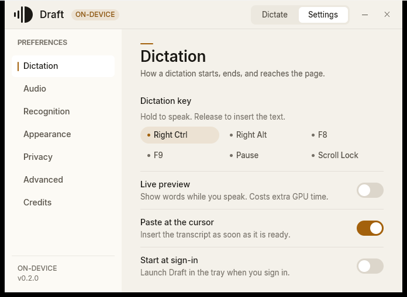
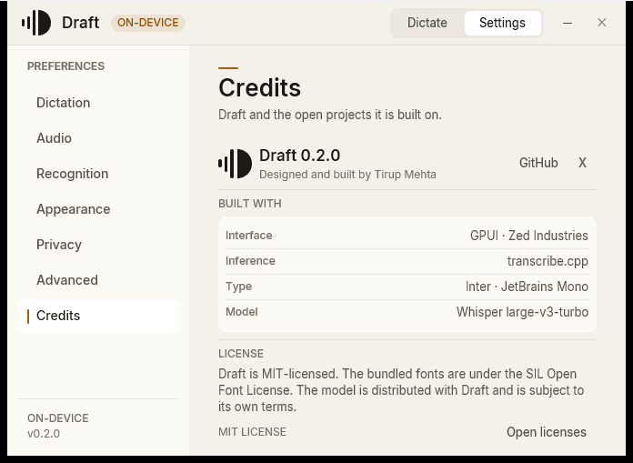

# Draft

**Private dictation for Windows.** Hold a key, speak, release — the words appear
at your cursor. The model runs on your machine.

Local Whisper large-v3-turbo · Vulkan · Native Rust · No account · No telemetry

[Download](#install) · [Project](https://github.com/TirupMehta/draft-rs) ·
[GitHub](https://github.com/TirupMehta) · [X](https://x.com/TirupMehta)


Draft is a native Windows dictation app built around a simple loop: hold the
key, speak naturally, and release. The audio is captured only while the key is
held, transcribed locally, pasted at the cursor, and discarded. There is no
cloud, no account, and no audio leaving the machine.

| Dictate | Listening | Recording HUD |
| --- | --- | --- |
|  |  |  |

| Settings | Credits |
| --- | --- |
|  |  |

## Why Draft

- **Local by construction.** Whisper large-v3-turbo runs warm on the GPU. Audio
  is never uploaded.
- **Fast enough to feel instant.** On the reference machine, a 3-second clip
  finishes in **239 ms p95**; an 11-second JFK recording in **264 ms p95**.
- **One clear gesture.** Six shortcut choices, a real input meter, and no
  modes to learn.
- **Quiet by default.** One final GPU pass per dictation. Live preview is an
  explicit opt-in because each preview is another full pass.
- **A real Windows app.** A fixed, GPU-rendered surface, a click-through
  recording HUD, a tray icon, and a per-user installer with no administrator
  prompt.
- **Honest.** The interface shows the real model state, the real input level,
  and the real latency. Nothing is simulated.

## What works today

- Hold **Right Ctrl** (or Right Alt, F8, F9, Pause, or Scroll Lock), speak,
  release, and the transcript is pasted at the cursor.
- Press **Esc** while recording to cancel the take.
- **Live preview** is available under Settings → Dictation. It is off by
  default; the final transcript always comes from the complete clip.
- The model loads once and stays warm. Vulkan is the shipping path, with a CPU
  fallback when a GPU backend is unavailable.
- A one-window interface: Dictate and Settings share the same 680×500 surface,
  so nothing resizes or jumps. Light is the default theme; dark is a designed
  second theme.
- A click-through recording HUD with a real waveform, elapsed time, and an
  honest Listening / Transcribing state.
- A microphone picker with a four-second level check and automatic fallback to
  the system default when a saved device disappears.
- Tray actions for Show, Hide, Paste last, and Quit. Draft starts in the tray
  at sign-in by default; the setting can be turned off.
- Bounded local history: text and duration only, never audio, window titles, or
  full URLs. A dedicated History pane is on the roadmap; the store and the
  `draftctl history` commands exist today.
- A resumable model installer that downloads the pinned F16 GGUF once, verifies
  its SHA-256, and installs it atomically.
- A per-user Windows installer with Start Menu and optional desktop shortcuts,
  a clean uninstall, and no console window.

## Privacy

Draft is built to be private without asking you to trust a policy.

- Audio is captured **only while the dictation key is held**.
- Speech is transcribed on this device and discarded. Draft does not keep the
  recording.
- History contains **text and duration only**.
- Settings, history, logs, and the model live under
  `%LOCALAPPDATA%\Draft4`.
- The Windows release installer includes the speech model, so dictation needs
  no network. If you build from source without the bundled model, the one-time
  model download is the only network exception: 1.63 GB, verified against a
  pinned SHA-256.
- There is no telemetry, analytics, crash reporting, or update ping.
- The GitHub and X actions on the Credits page open your browser only when you
  choose them.

## Performance

Measured on the reference machine: Intel Core i7-13620H, NVIDIA GeForce RTX
4060 Laptop 8 GB, Windows 11, Vulkan, F16 model, warm model, five measured
runs per clip. Decode only, before clipboard paste.

| Audio | Draft p95 | Draft v3.5 p95 | Speedup |
| --- | --- | --- | --- |
| 3 s | **239 ms** | 996 ms | 4.17× |
| 5 s | **234 ms** | 929 ms | 3.97× |
| 15 s | **375 ms** | 1,139 ms | 3.04× |
| 30 s | **543 ms** | 1,601 ms | 2.95× |
| 60 s | **1,186 ms** | 3,036 ms | 2.56× |
| JFK, 11 s | **264 ms** | — | — |

These numbers are a baseline, not a promise for every GPU. The full method and
the raw reports are in [docs/PERFORMANCE.md](docs/PERFORMANCE.md).

## Install

**Windows 10/11, x64.**

1. Download `Draft-Setup-0.2.0.exe` from
   [Releases](https://github.com/TirupMehta/draft-rs/releases/latest).
2. Run the installer. It installs for the current user under
   `%LOCALAPPDATA%\Programs\Draft`; no administrator prompt is needed.
3. The release installer includes the speech model; no separate download is
   needed. If you build an installer without `-IncludeModel`, run
   `draftctl model install` once to fetch and verify it.
4. Hold **Right Ctrl**, speak, and release. The text appears at your cursor.

The installer is **not code-signed yet**, so Windows SmartScreen may show a
warning on first run. You can verify the download against the release notes, or
build from source.

## Build from source

Requirements: Rust stable, Microsoft C++ Build Tools, CMake, and the Vulkan SDK.
On Windows, the setup script installs the toolchain pieces it can and tells you
what still needs a manual step.

```powershell
git clone https://github.com/TirupMehta/draft-rs.git
cd draft-rs
powershell -ExecutionPolicy Bypass -File .\scripts\setup-windows.ps1
cargo run -p draft-desktop
```

The app looks for the F16 model at
`%LOCALAPPDATA%\Draft4\models\whisper-large-v3-turbo-F16.gguf`. To download and
verify it from the command line:

```powershell
cargo run -p draft -- model install
cargo run -p draft -- model status
```

`draftctl` also exposes `model list`, `model verify`, `model remove`,
`transcribe`, `bench`, `mic`, `listen`, and `history`.

Run the same gates as CI before sending a change:

```powershell
cargo fmt --all -- --check
cargo clippy --workspace --all-targets -- -D warnings
cargo test --workspace
cargo build --workspace --release
```

### Installer

Inno Setup 6 is the only extra tool:

```powershell
cargo build --workspace --release
.\scripts\build-installer.ps1
```

That writes `dist\Draft-Setup-<version>.exe`. Add `-IncludeModel` to embed the
installed GGUF for an offline install. Uninstall removes the app and shortcuts
but keeps settings, history, logs, and models under `%LOCALAPPDATA%\Draft4`.

## Architecture

```text
crates/draft-core      settings, history, text cleanup, model catalog, paths
crates/draft-engine    transcribe.cpp GGUF inference (Vulkan / CPU)
crates/draft-audio     cpal capture, 16 kHz resample, live level
crates/draft-hotkey    low-level Windows keyboard hook
crates/draft-paste     clipboard insertion
crates/draft-cli       the draftctl development binary
apps/desktop           the GPUI shell (the product UI)
assets                 app icon and bundled Inter / JetBrains Mono
bench                  fixtures, baseline scripts, latency measurements
docs                   specification, roadmap, performance, handoff
packaging/windows      the Inno Setup installer
scripts                toolchain and release helpers
```

`draft-core` owns behavior that is not platform-specific. Platform crates own
windows, microphones, hotkeys, clipboards, trays, and permissions. No OS-specific
type crosses into the core.

## Status and limitations

Draft 0.2.0 is an early Windows release.

- Windows x64 is the only supported target today; macOS and Linux shells are
  future work.
- The installer is unsigned.
- The History pane is not built; the bounded store and `draftctl history` are
  available.
- Real-speech WER parity with Draft v3.5 is still being measured. It is the
  next release gate, and no accuracy claim is made ahead of it.
- Updates are manual; there is no in-app updater.

## Credits

Draft is designed and built by [Tirup Mehta](https://github.com/TirupMehta).
It is built on **GPUI** by Zed Industries (Apache-2.0), **transcribe.cpp**
(MIT), **Whisper large-v3-turbo** by OpenAI in a GGUF build by handy-computer,
**Inter** by Rasmus Andersson (OFL 1.1), and **JetBrains Mono** by JetBrains
(OFL 1.1). The full list is in [CREDITS.md](CREDITS.md), and every Rust
dependency is listed in [THIRD_PARTY_NOTICES.md](THIRD_PARTY_NOTICES.md).

The Credits section is also available in the app, under Settings → Credits,
with links to GitHub and X and a button that opens the installed license files.

## Contributing

Read [CONTRIBUTING.md](CONTRIBUTING.md) before opening a change. It covers the
Windows setup, the design rules, the checks that must pass, and the license.

## License

Draft is released under the [MIT License](LICENSE). The bundled typefaces are
under the SIL Open Font License 1.1. The speech model is distributed with
Draft and is subject to its own terms. See [NOTICE](NOTICE),
[CREDITS.md](CREDITS.md), and [THIRD_PARTY_NOTICES.md](THIRD_PARTY_NOTICES.md).
