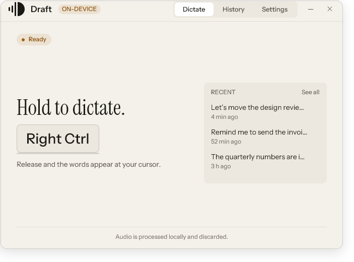
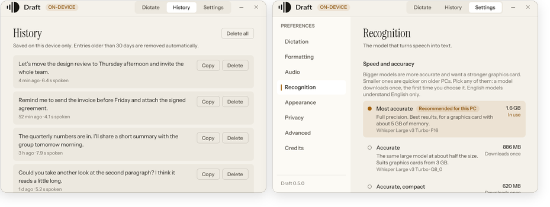
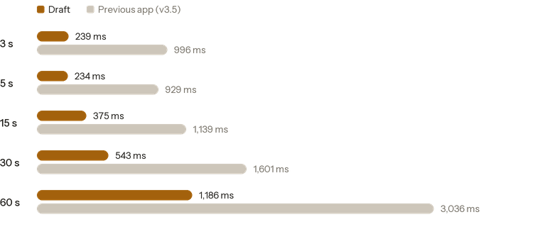

<picture>
  <source media="(prefers-color-scheme: dark)" srcset="docs/images/wordmark-dark.png">
  
</picture>

**Private dictation for Windows.** Hold a key, speak, release. The words appear
at your cursor, and your voice never leaves your PC.

[](https://github.com/TirupMehta/draft-rs/releases/latest)

[](LICENSE)


[Website](https://draft.tirup.in) ·
[Download](https://github.com/TirupMehta/draft-rs/releases/latest) ·
[Offline dictation](https://draft.tirup.in/offline-dictation) ·
[Whisper on Windows](https://draft.tirup.in/whisper-dictation-windows)

<br>



## Why Draft

- **Private.** Whisper runs on your PC. Audio is captured only while you hold
  the key, then discarded. No account, no telemetry.
- **Fast.** About 50 times faster than you speak on a GPU: a minute of speech
  in 1.2 seconds.
- **Fits your PC.** Seven models from 85 MB to 1.6 GB. Draft measures your
  hardware and recommends one.
- **Readable.** Paragraph breaks at real pauses, spoken commands, optional
  lists. It never changes a word.
- **Free.** MIT licensed. No subscription.

## Install

Download an installer from the
[latest release](https://github.com/TirupMehta/draft-rs/releases/latest) and run
it. No administrator rights are needed.

- `Draft-Setup-<version>.exe` (11 MB). **Recommended.** Downloads the right
  model for your PC once, on first launch.
- `Draft-Setup-<version>-offline-small.exe` (257 MB). For PCs with no internet,
  older hardware, or no GPU. Includes Whisper Small.
- `Draft-Setup-<version>-offline.exe` (1.43 GB). For PCs with no internet and a
  capable GPU. Includes Whisper Large v3 Turbo.

Draft needs Windows 10 or 11 (x64) and a CPU with AVX2, which covers any PC made
since 2013. A Vulkan GPU gives the fast path. Without one, Draft runs on the CPU
and is slower.

> [!NOTE]
> The installer is not code-signed yet, so Windows SmartScreen may warn on the
> first run. Choose **More info**, then **Run anyway**. Each installer has a
> `.sha256` file on the release page to check it against:
> `Get-FileHash .\Draft-Setup-<version>.exe -Algorithm SHA256`

To uninstall, use **Uninstall Draft** in the Start menu. Your settings, history,
and model in `%LOCALAPPDATA%\Draft4` are kept, so a reinstall does not download
the model again.

## Use

Click into any text field, hold **Right Ctrl**, speak, and release. The
transcript is pasted at your cursor. Press **Esc** to cancel a take. You can
change the key to Right Alt, F8, F9, Pause, or Scroll Lock in Settings.

- **Paragraphs.** Draft breaks at a real pause, measured against your own
  speaking rhythm. It never rewrites, adds, or reorders a word.
- **Spoken commands.** Say `new paragraph`, `new line`, or `scratch that` as its
  own phrase, with a pause on each side. Optional lists respond to
  `make a list` and `make a numbered list`.
- **Live preview.** Shows words as you speak. Off by default, because each
  preview costs another GPU pass.
- **History.** Your newest 50 dictations, with Copy and Delete. Text and
  duration only, never audio, and nothing older than 30 days.
- **Tray.** Show, hide, paste your last dictation, or quit. Draft starts in the
  tray at sign-in unless you turn that off.



## Models

Draft recommends one model for your PC and downloads it once from a pinned
Hugging Face file, verifying its SHA-256. You can change it in Settings, under
Recognition.

- **Most accurate.** Whisper Large v3 Turbo, F16. 1.6 GB, for a GPU with about
  5 GB of memory.
- **Accurate.** The same model at Q8_0. 886 MB, for GPUs from 3 GB.
- **Accurate, compact.** The same model at Q5_K_M. 620 MB, for 2 GB GPUs and
  tight memory.
- **Balanced.** Whisper Small, 270 MB, for most PCs. There is an English-only
  version of the same size.
- **Light.** Whisper Base, 85 MB, for older or slower PCs. There is an
  English-only version of the same size.

## Performance

<picture>
  <source media="(prefers-color-scheme: dark)" srcset="docs/images/chart-dark.png">
  
</picture>

A minute of speech takes about 1.2 seconds, roughly 50 times faster than real
time, and Draft is 2.6 to 4.2 times faster than the previous app (v3.5) on the
same clips. Short clips carry a fixed cost of about 0.2 seconds, so a 3-second
clip is not proportionally faster.

These are p95 times of five runs on one reference machine: an Intel Core
i7-13620H with an NVIDIA GeForce RTX 4060 Laptop GPU (8 GB), Windows 11,
Vulkan, the F16 model, warm. They cover decoding only, before the paste, and are
not a guarantee for other hardware. Without a GPU, Draft runs on the CPU and
takes a few seconds per clip. The method and raw reports are in
[docs/PERFORMANCE.md](docs/PERFORMANCE.md).

## Privacy

- Audio is captured only while the dictation key is held. It is transcribed on
  your PC and discarded.
- History is text and duration only. Settings, history, logs, a learned pause
  profile (timing numbers, no words), and the model live in
  `%LOCALAPPDATA%\Draft4`.
- The only network request is the speech model. The standard installer
  downloads it once; the offline installers include one.
- There is no telemetry and no update check. Updates are manual.

## Troubleshooting

- **Windows says it protected my PC.** See the note under [Install](#install).
- **Text is not pasted.** Check that **Paste at the cursor** is on in Settings,
  under Dictation, and that the cursor is in a text field when you release the
  key.
- **Wrong microphone.** Pick one in Settings, under Audio, and run the
  four-second level check. If a saved device disappears, Draft falls back to the
  system default.
- **Dictation takes several seconds.** Draft is probably running on the CPU
  because it found no usable GPU. Choose a smaller model in Settings, under
  Recognition.
- **Deleting my data.** Delete dictations from the History tab, or remove
  `%LOCALAPPDATA%\Draft4` to clear everything.

## Building from source

You need Rust (stable), the Microsoft C++ Build Tools, CMake, and the Vulkan SDK.

```shell
git clone https://github.com/TirupMehta/draft-rs.git
cd draft-rs
cargo run -p draft-desktop --release
```

Before sending a change, run the checks CI runs:

```shell
cargo fmt --all -- --check
cargo clippy --workspace --all-targets -- -D warnings
cargo test --workspace
cargo build --workspace --release
```

To build the installer, install Inno Setup 6, build the release binary, copy it
to `dist\draft.exe`, and run `scripts\build-installer.ps1`. Add `-IncludeModel`
for an offline installer, with `-ModelPath` and `-Suffix` to pick its model and
file name. [AGENTS.md](AGENTS.md) maps the code.

## Status

Draft is an early release. The installer is not code-signed, there is no in-app
updater, and accuracy against the previous app on real speech is still being
measured, so Draft makes no accuracy claim yet. A macOS preview for Apple
Silicon is on the
[macOS prerelease](https://github.com/TirupMehta/draft-rs/releases/tag/v0.2.0-macos.1);
it is not notarized and has not been run on a physical Mac. Linux is not
supported.

## Documentation

[Spec](docs/SPEC.md) ·
[Performance](docs/PERFORMANCE.md) ·
[Roadmap](docs/ROADMAP.md) ·
[macOS](docs/MACOS.md) ·
[Code signing](docs/CODE_SIGNING.md) ·
[Contributing](CONTRIBUTING.md) ·
[Working notes](AGENTS.md)

## License

Draft is released under the [MIT License](LICENSE). The bundled typefaces are
under the SIL Open Font License 1.1. The speech model is distributed with Draft
and is subject to its own terms. See [NOTICE](NOTICE),
[CREDITS.md](CREDITS.md), and [THIRD_PARTY_NOTICES.md](THIRD_PARTY_NOTICES.md).
Draft is an independent project and is not affiliated with OpenAI.

Designed and built by [Tirup Mehta](https://github.com/TirupMehta).
