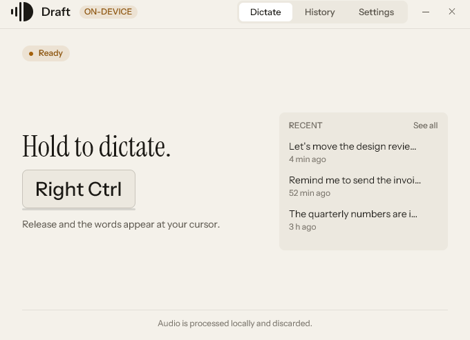
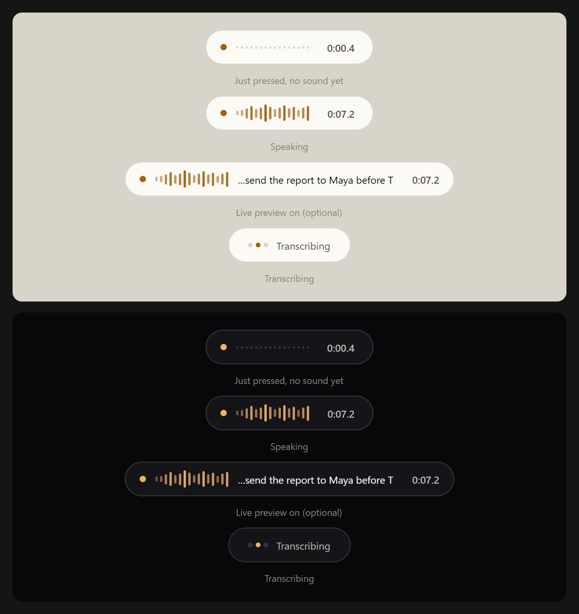
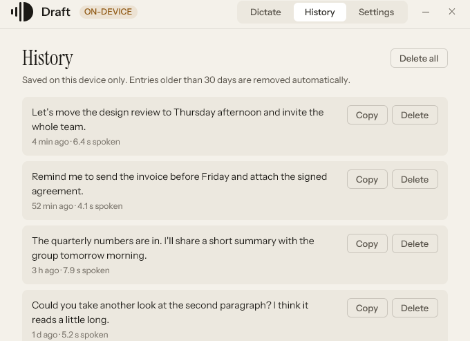
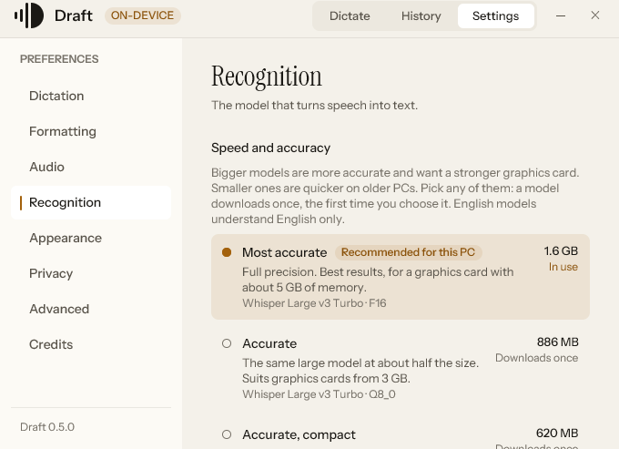
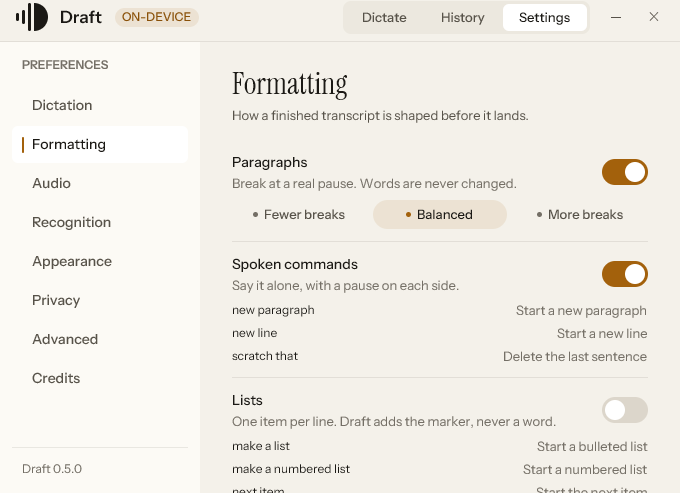
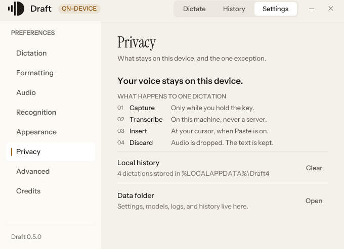

# Draft

**Private dictation for Windows.** Hold a key, speak, release. The words appear
at your cursor, and your voice never leaves your PC.

[](https://github.com/TirupMehta/draft-rs/releases/latest)

[](LICENSE)


[Install](#install) ·
[Use](#use) ·
[Models](#models) ·
[Performance](#performance) ·
[Privacy](#privacy) ·
[Build](#build-from-source) ·
[Docs](#documentation)

<p align="center">
<picture>
  <source media="(prefers-color-scheme: dark)" srcset="docs/screenshots/dictate-dark.png">
  
</picture>
</p>

Draft is a native Windows app that turns speech into text wherever your cursor
is: an editor, a browser, a chat box. It runs OpenAI's Whisper on your own
machine, on the GPU when there is one, so nothing is uploaded and there is no
account to create. It is free and MIT licensed.

- **Local.** Audio is captured only while the key is held, transcribed on this
  PC, and discarded.
- **Fast.** On a GPU, about 50× faster than you speak: a minute of speech is
  transcribed in 1.19 s ([details](#performance)).
- **Readable.** Paragraph breaks at real pauses, spoken commands, optional
  lists. Formatting never changes a word.
- **Scaled to your PC.** Seven Whisper models from 85 MB to 1.6 GB. Draft
  measures your hardware and recommends one.

## Install

**Requirements:** Windows 10 or 11 (x64) on a CPU with AVX2, which means any PC
from 2013 on. Any Vulkan GPU gives the fast path. Without one, Draft runs on the
CPU and is slower.

Download an installer from the
[latest release](https://github.com/TirupMehta/draft-rs/releases/latest):

| Installer | File | Size | Model |
| --- | --- | --- | --- |
| **Standard (recommended)** | `Draft-Setup-<version>.exe` | 11 MB | Chosen for your PC and downloaded once, on first launch |
| Offline, small | `Draft-Setup-<version>-offline-small.exe` | 257 MB | Whisper Small, included. For older PCs and machines without a GPU |
| Offline, full | `Draft-Setup-<version>-offline.exe` | 1.43 GB | Whisper Large v3 Turbo, included. For PCs with a capable GPU |

Most people should take the standard installer. Choose an offline installer
only for a PC with no internet connection.

1. Run the installer. It installs for the current user to
   `%LOCALAPPDATA%\Programs\Draft`, so it needs no administrator rights.
2. Start Draft. The standard installer picks a model, downloads it once with a
   progress bar, and verifies its checksum.
3. Hold **Right Ctrl**, speak, and release.

The installer is not code-signed yet, so Windows SmartScreen may warn on the
first run: choose **More info**, then **Run anyway**. To check a download first,
compare it with the `.sha256` file on the release page:

```powershell
Get-FileHash .\Draft-Setup-<version>.exe -Algorithm SHA256
```

**Uninstall** from the Start menu (Draft → Uninstall Draft). Your settings,
history and model in `%LOCALAPPDATA%\Draft4` are kept, so a reinstall does not
download the model again. Delete that folder for a clean slate.

> **macOS.** An early Apple Silicon preview is available as an ad-hoc-signed,
> unnotarized DMG on the
> [macOS prerelease](https://github.com/TirupMehta/draft-rs/releases/tag/v0.2.0-macos.1).
> It builds and links on Apple hardware, but no one has dictated on a physical
> Mac yet. See [docs/MACOS.md](docs/MACOS.md). Linux is not planned.

## Use

Hold **Right Ctrl**, speak, and release. The transcript is pasted at your
cursor. Press **Esc** while recording to cancel. You can change the key to
Right Alt, F8, F9, Pause or Scroll Lock in Settings.

A small pill appears while you hold the key. It shows your real input level and
the length of the take, and it never takes focus from the app you are typing in.

<p align="center">
  
</p>
<p align="center"><sub>The four HUD states. The words in the live-preview row are an example.</sub></p>

**Formatting.** Draft breaks a paragraph at a real pause, measured against your
own speaking rhythm, which it learns on your PC. It never rewrites, adds or
reorders a word. Choose fewer or more breaks in Settings → Formatting.

**Spoken commands.** Say `new paragraph`, `new line` or `scratch that` as its
own phrase, with a pause on each side. The same words inside a sentence are left
alone. Lists are opt-in: when enabled, `make a list` and `make a numbered list`
turn what follows into one item per line.

**Live preview** shows words as you speak. It is off by default because every
preview is another GPU pass, and the final transcript always comes from the
complete clip.

**History.** The History tab lists your newest 50 dictations with Copy and
Delete, and a two-click Delete all. It stores text and duration only, never
audio, and entries older than 30 days are removed automatically.

**Tray.** Show Draft, Hide Draft, Paste last dictation, and Quit Draft. Draft starts
in the tray at sign-in unless you turn that off.

## Models

Draft offers a seven-step ladder. It measures your GPU, memory and CPU, marks
one step as recommended, and downloads it once from pinned Hugging Face files
whose SHA-256 it verifies. Change it any time in Settings → Recognition.

| Step | Model | Size | Suits |
| --- | --- | --- | --- |
| Most accurate | Whisper Large v3 Turbo, F16 | 1.6 GB | A GPU with about 5 GB of memory |
| Accurate | Whisper Large v3 Turbo, Q8_0 | 886 MB | GPUs from 3 GB |
| Accurate, compact | Whisper Large v3 Turbo, Q5_K_M | 620 MB | 2 GB GPUs and tight memory |
| Balanced | Whisper Small, Q8_0 | 270 MB | Most PCs, with or without a GPU |
| Balanced, English | Whisper Small English, Q8_0 | 270 MB | As above, English only |
| Light | Whisper Base, Q8_0 | 85 MB | Older or slower PCs |
| Light, English | Whisper Base English, Q8_0 | 85 MB | The smallest English model |

## Performance

Measured on one reference machine: Intel Core i7-13620H, NVIDIA GeForce RTX 4060
Laptop (8 GB), Windows 11, Vulkan, the F16 model, warm. Each figure is the p95 of
five runs, decode only, before the paste.

| Audio | Draft | Previous app (v3.5) | Speedup |
| --- | --- | --- | --- |
| 3 s | 239 ms | 996 ms | 4.17× |
| 5 s | 234 ms | 929 ms | 3.97× |
| 15 s | 375 ms | 1,139 ms | 3.04× |
| 30 s | 543 ms | 1,601 ms | 2.95× |
| 60 s | 1,186 ms | 3,036 ms | 2.56× |
| 11 s, a real recording | 264 ms | n/a | n/a |

A minute of speech in 1.19 s is about 50× faster than real time. Short clips
carry a fixed cost of roughly 0.2 s, because the encoder always processes a
30-second window, so a 3-second clip is not proportionally faster than a
5-second one. The method and the raw reports are in
[docs/PERFORMANCE.md](docs/PERFORMANCE.md).

These numbers are a baseline for one laptop, not a promise for every GPU. Without
a GPU, Draft runs the model on the CPU and takes a few seconds per clip. It uses
three quarters of the logical CPUs, which measured 26–40% faster than using all
of them.

## Privacy

Draft is built to be private without asking you to trust a policy.

- Audio is captured **only while the dictation key is held**. It is transcribed
  on this PC and discarded. Draft does not keep the recording.
- History is **text and duration only**, kept on this PC.
- Settings, history, logs, the learned pause profile (timing numbers, no words)
  and the model all live in `%LOCALAPPDATA%\Draft4`.
- The one network request is the speech model. The standard installer downloads
  the model you choose once, on first launch, from a pinned Hugging Face file
  and verifies its SHA-256. The offline installers bundle a model instead. After
  that, dictation needs no network.
- There is no telemetry, analytics, crash reporting or update check. Updates
  are manual.
- The GitHub and X links on the Credits page open your browser only when you
  choose them.

## Screenshots

| | |
| --- | --- |
| <picture><source media="(prefers-color-scheme: dark)" srcset="docs/screenshots/history-dark.png"></picture> | <picture><source media="(prefers-color-scheme: dark)" srcset="docs/screenshots/recognition-dark.png"></picture> |
| **History.** Your newest dictations, text and duration only. | **Recognition.** The model ladder, with a recommendation for your PC. |
| <picture><source media="(prefers-color-scheme: dark)" srcset="docs/screenshots/formatting-dark.png"></picture> | <picture><source media="(prefers-color-scheme: dark)" srcset="docs/screenshots/privacy-dark.png"></picture> |
| **Formatting.** Paragraphs at real pauses, spoken commands, lists. | **Privacy.** What happens to one dictation, and where your data lives. |

## Status

Draft is an early release for Windows 10 and 11 (x64).

- The installer is not code-signed, so SmartScreen warns on first run.
- Accuracy against the previous app (v3.5) on real speech is still being
  measured, and no accuracy claim is made until it is.
- Updates are manual. There is no in-app updater.
- macOS is a preview and Linux is not planned.

The open work is tracked in [docs/ROADMAP.md](docs/ROADMAP.md).

## Build from source

You need Rust (stable), the Microsoft C++ Build Tools, CMake and the Vulkan SDK.

```text
git clone https://github.com/TirupMehta/draft-rs.git
cd draft-rs
cargo run -p draft-desktop --release
```

Run the same checks as CI before you send a change:

```text
cargo fmt --all -- --check
cargo clippy --workspace --all-targets -- -D warnings
cargo test --workspace
cargo build --workspace --release
```

To build the installer, install Inno Setup 6, build the release binary, copy it
to `dist\draft.exe`, then run `scripts\build-installer.ps1`. Add `-IncludeModel`
for an offline installer, with `-ModelPath` and `-Suffix` to choose the model and
the file name.

`draftctl`, a command-line tool in the same workspace, manages models
(`draftctl model install|status|verify`), searches history, and runs the
benchmarks.

The workspace is split so that platform code stays out of the core:

| Path | Responsibility |
| --- | --- |
| `crates/draft-core` | Settings, history, text formatting, model catalog, paths |
| `crates/draft-engine` | Whisper inference through transcribe.cpp (Vulkan or CPU) |
| `crates/draft-audio` | Microphone capture, 16 kHz resampling, live level |
| `crates/draft-hotkey` | The hold-to-talk key |
| `crates/draft-paste` | Clipboard insertion |
| `crates/draft-cli` | The `draftctl` binary |
| `apps/desktop` | The GPUI interface: window, HUD, tray |
| `packaging/windows` | The Inno Setup installer |

## Documentation

| Document | Contents |
| --- | --- |
| [docs/SPEC.md](docs/SPEC.md) | Product intent and scope |
| [docs/PERFORMANCE.md](docs/PERFORMANCE.md) | Benchmark method, GPU and CPU tables, raw reports |
| [docs/ROADMAP.md](docs/ROADMAP.md) | Open work and release gates |
| [docs/MACOS.md](docs/MACOS.md) | What is and is not verified on macOS |
| [docs/CODE_SIGNING.md](docs/CODE_SIGNING.md) | Signing plan for the installer |
| [CONTRIBUTING.md](CONTRIBUTING.md) | Setup, design rules and required checks |
| [AGENTS.md](AGENTS.md) | Working notes for anyone changing the code |

## Credits and license

Draft is designed and built by [Tirup Mehta](https://github.com/TirupMehta)
([X](https://x.com/TirupMehta)). It stands on GPUI by Zed Industries
(Apache-2.0), transcribe.cpp (MIT), Whisper large-v3-turbo by OpenAI in a GGUF
build by handy-computer, and the Instrument Sans and Instrument Serif typefaces
(OFL 1.1). The full list is in [CREDITS.md](CREDITS.md), and every Rust
dependency is listed in [THIRD_PARTY_NOTICES.md](THIRD_PARTY_NOTICES.md).

Draft is released under the [MIT License](LICENSE). The bundled typefaces are
under the SIL Open Font License 1.1. The speech model is distributed with Draft
and is subject to its own terms. See [NOTICE](NOTICE).
