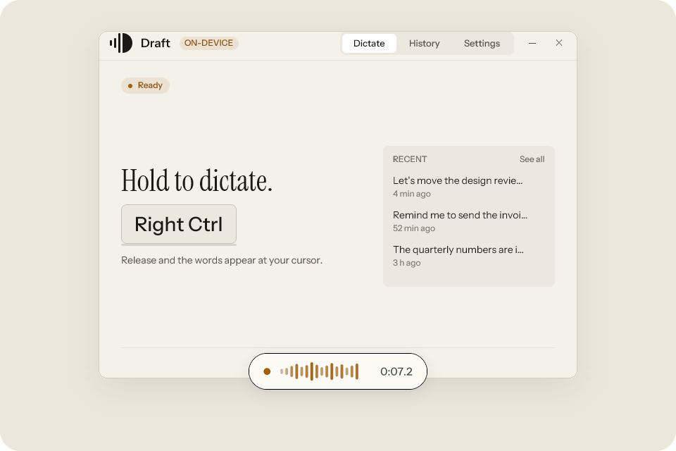
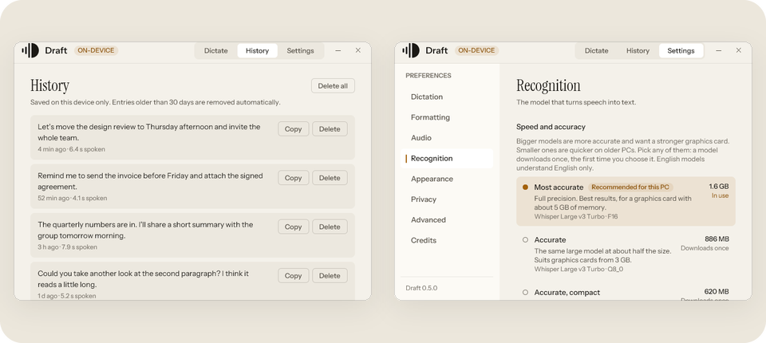

<picture>
  <source media="(prefers-color-scheme: dark)" srcset="docs/images/banner-dark.png">
  
</picture>

**Private dictation for Windows.** Hold a key, speak, release. The words appear
at your cursor, and your voice never leaves your PC.

[](https://github.com/TirupMehta/draft-rs/releases/latest)

[](LICENSE)


[**Download**](https://github.com/TirupMehta/draft-rs/releases/latest) ·
[Quick start](#quick-start) ·
[Usage](#usage) ·
[Performance](#performance) ·
[Privacy](#privacy) ·
[Troubleshooting](#troubleshooting) ·
[Build](#building-from-source)

<picture>
  <source media="(prefers-color-scheme: dark)" srcset="docs/images/hero-dark.png">
  
</picture>

|  |  |
| :--- | :--- |
| **Private** | Audio is captured only while the key is held, then discarded. No account, no telemetry. |
| **Fast** | About 50× faster than you speak on a GPU: a minute of speech in 1.2 seconds. |
| **Scaled to your PC** | Seven Whisper models from 85 MB to 1.6 GB. Draft measures your hardware and recommends one. |
| **Readable** | Paragraph breaks at real pauses, spoken commands, optional lists. Never changes a word. |
| **Free** | MIT licensed. No subscription, no paid tier. |

## Quick start

1. Download `Draft-Setup-<version>.exe` from the
   [latest release](https://github.com/TirupMehta/draft-rs/releases/latest) and
   run it. It needs no administrator rights.
2. Start Draft. On first launch it picks a model for your PC and downloads it
   once.
3. Click into any text field, hold **Right Ctrl**, speak, and release.

> [!NOTE]
> The installer is not code-signed yet, so Windows SmartScreen may warn on the
> first run. Choose **More info**, then **Run anyway**. You can check the
> download against its `.sha256` file first; see [Verifying a download](#verifying-a-download).

## Installation

**Requirements.** Windows 10 or 11 (x64) on a CPU with AVX2, which covers any PC
made since 2013. A Vulkan GPU gives the fast path. Without one, Draft runs on
the CPU and is slower.

**Choosing an installer.** Use the standard installer unless the target PC has
no internet connection.

| Installer | Size | Model | Choose it when |
| :--- | ---: | :--- | :--- |
| `Draft-Setup-<version>.exe` | 11 MB | Downloaded once, on first launch | You are online (recommended) |
| `Draft-Setup-<version>-offline-small.exe` | 257 MB | Whisper Small, included | You are offline, on an older PC or one without a GPU |
| `Draft-Setup-<version>-offline.exe` | 1.43 GB | Whisper Large v3 Turbo, included | You are offline, on a PC with a capable GPU |

### Verifying a download

Each installer has a `.sha256` file on the release page. Compare it with:

```powershell
Get-FileHash .\Draft-Setup-<version>.exe -Algorithm SHA256
```

### Uninstalling

Use **Uninstall Draft** in the Start menu. Your settings, history, and model in
`%LOCALAPPDATA%\Draft4` are kept, so a reinstall does not download the model
again. Delete that folder to remove them.

> [!NOTE]
> An early Apple Silicon preview is on the
> [macOS prerelease](https://github.com/TirupMehta/draft-rs/releases/tag/v0.2.0-macos.1).
> It is not notarized and has not been run on a physical Mac; see
> [docs/MACOS.md](docs/MACOS.md). Linux is not supported.

## Usage

Hold **Right Ctrl**, speak, and release. The transcript is pasted at the cursor.
Press **Esc** while recording to cancel. You can change the key to Right Alt,
F8, F9, Pause, or Scroll Lock in Settings. While you hold it, a small indicator
shows the input level and the length of the take, and never takes focus from the
window you are typing in.

| Feature | How it works |
| :--- | :--- |
| **Formatting** | A paragraph break is inserted at a real pause, measured against your own speaking rhythm, which Draft learns on your PC. It never rewrites, adds, or reorders a word. |
| **Spoken commands** | Say `new paragraph`, `new line`, or `scratch that` as its own phrase, with a pause on each side. The same words inside a sentence are left alone. |
| **Lists** | Off by default. When enabled, `make a list` and `make a numbered list` put one item on each line. |
| **Live preview** | Shows words as you speak. Off by default, because each preview is another GPU pass. The final transcript always comes from the whole clip. |
| **History** | The History tab lists your newest 50 dictations with Copy and Delete. It stores text and duration only, never audio, and removes entries older than 30 days. |
| **Tray** | Show Draft, Hide Draft, Paste last dictation, Quit Draft. Draft starts in the tray at sign-in unless you turn that off. |

<picture>
  <source media="(prefers-color-scheme: dark)" srcset="docs/images/screens-dark.png">
  
</picture>

## Models

Draft marks one model as recommended for your PC and downloads it once from a
pinned Hugging Face file, verifying its SHA-256. Change it any time in
Settings → Recognition.

| Step | Model | Size | Suits |
| :--- | :--- | ---: | :--- |
| Most accurate | Whisper Large v3 Turbo, F16 | 1.6 GB | A GPU with about 5 GB of memory |
| Accurate | Whisper Large v3 Turbo, Q8_0 | 886 MB | GPUs from 3 GB |
| Accurate, compact | Whisper Large v3 Turbo, Q5_K_M | 620 MB | 2 GB GPUs and tight memory |
| Balanced | Whisper Small, Q8_0 | 270 MB | Most PCs, with or without a GPU |
| Balanced, English | Whisper Small English, Q8_0 | 270 MB | As above, English only |
| Light | Whisper Base, Q8_0 | 85 MB | Older or slower PCs |
| Light, English | Whisper Base English, Q8_0 | 85 MB | The smallest English model |

## Performance

Measured on one reference machine: an Intel Core i7-13620H with an NVIDIA
GeForce RTX 4060 Laptop GPU (8 GB), Windows 11, the Vulkan backend, the F16
model, and a warm model. Each figure is the p95 of five runs, covering decoding
only, before the paste.

| Audio | Draft | Previous app (v3.5) | Speedup |
| ---: | ---: | ---: | ---: |
| 3 s | 239 ms | 996 ms | 4.17× |
| 5 s | 234 ms | 929 ms | 3.97× |
| 15 s | 375 ms | 1,139 ms | 3.04× |
| 30 s | 543 ms | 1,601 ms | 2.95× |
| 60 s | **1,186 ms** | 3,036 ms | 2.56× |

A minute of speech takes about 1.2 seconds, roughly 50 times faster than real
time. Short clips carry a fixed cost of about 0.2 seconds, so a 3-second clip is
not proportionally faster. These numbers describe one laptop and are not a
guarantee for other hardware. Without a GPU, Draft runs on the CPU and takes a
few seconds per clip. The method and raw reports are in
[docs/PERFORMANCE.md](docs/PERFORMANCE.md).

## Privacy

- Audio is captured **only while the dictation key is held**. It is transcribed
  on your PC and discarded.
- History contains **text and duration only**. Settings, history, logs, a
  learned pause profile (timing numbers, no words), and the model live in
  `%LOCALAPPDATA%\Draft4`.
- The **only network request** is the speech model. The standard installer
  downloads it once; the offline installers include one.
- Draft sends no telemetry and does not check for updates. Updates are manual.

## Troubleshooting

**Windows says it protected my PC.** The installer is not code-signed yet. Verify
its hash, then choose **More info** and **Run anyway**.

**Text is not pasted at my cursor.** Check that **Paste at the cursor** is on in
Settings → Dictation, and that the cursor is inside a text field when you
release the key.

**Draft uses the wrong microphone.** Open Settings → Audio to pick one and run
the four-second level check. If a saved device disappears, Draft falls back to
the system default.

**Dictation takes several seconds.** Draft is probably running on the CPU because
no usable GPU was found. Choose a smaller model in Settings → Recognition.

**I want to delete my data.** Delete single dictations or all of them from the
History tab, or remove `%LOCALAPPDATA%\Draft4` to clear everything.

## Building from source

You need Rust (stable), the Microsoft C++ Build Tools, CMake, and the Vulkan SDK.

```shell
git clone https://github.com/TirupMehta/draft-rs.git
cd draft-rs
cargo run -p draft-desktop --release
```

Before sending a change, run the same checks as CI:

```shell
cargo fmt --all -- --check
cargo clippy --workspace --all-targets -- -D warnings
cargo test --workspace
cargo build --workspace --release
```

To build the installer, install Inno Setup 6, build the release binary, copy it
to `dist\draft.exe`, and run `scripts\build-installer.ps1`. Pass
`-IncludeModel` for an offline installer, with `-ModelPath` and `-Suffix` to
choose its model and file name. The `draftctl` tool in the same workspace
manages models, searches history, and runs the benchmarks.

The code is a Cargo workspace. `draft-core` holds the platform-independent
logic; `draft-audio`, `draft-hotkey`, and `draft-paste` handle the microphone,
the key, and the clipboard; `apps/desktop` is the interface. [AGENTS.md](AGENTS.md)
has a full map.

## Project status

Draft is an early release.

- The installer is not code-signed.
- Accuracy compared with the previous app (v3.5) on real speech is still being
  measured, and Draft makes no accuracy claim until it is.
- There is no in-app updater.

## Documentation

| Document | Contents |
| :--- | :--- |
| [docs/SPEC.md](docs/SPEC.md) | Product intent and scope |
| [docs/PERFORMANCE.md](docs/PERFORMANCE.md) | Benchmark method and results |
| [docs/ROADMAP.md](docs/ROADMAP.md) | Open work and release gates |
| [docs/MACOS.md](docs/MACOS.md) | What is and is not verified on macOS |
| [docs/CODE_SIGNING.md](docs/CODE_SIGNING.md) | Plan for signing the installer |
| [AGENTS.md](AGENTS.md) | Working notes for anyone changing the code |

## Contributing

Contributions are welcome. Please read [CONTRIBUTING.md](CONTRIBUTING.md) before
opening a change. It covers the setup, the design rules, and the checks that
must pass.

## License

Draft is released under the [MIT License](LICENSE). The bundled typefaces are
under the SIL Open Font License 1.1. The speech model is distributed with Draft
and is subject to its own terms. See [NOTICE](NOTICE).

Draft is an independent project and is not affiliated with OpenAI.

## Acknowledgments

Draft is designed and built by [Tirup Mehta](https://github.com/TirupMehta). It
is built on [GPUI](https://github.com/zed-industries/zed) by Zed Industries,
transcribe.cpp, Whisper by OpenAI in a GGUF build by handy-computer, and the
Instrument Sans and Instrument Serif typefaces. [CREDITS.md](CREDITS.md) has the
full list, and [THIRD_PARTY_NOTICES.md](THIRD_PARTY_NOTICES.md) lists every Rust
dependency.
